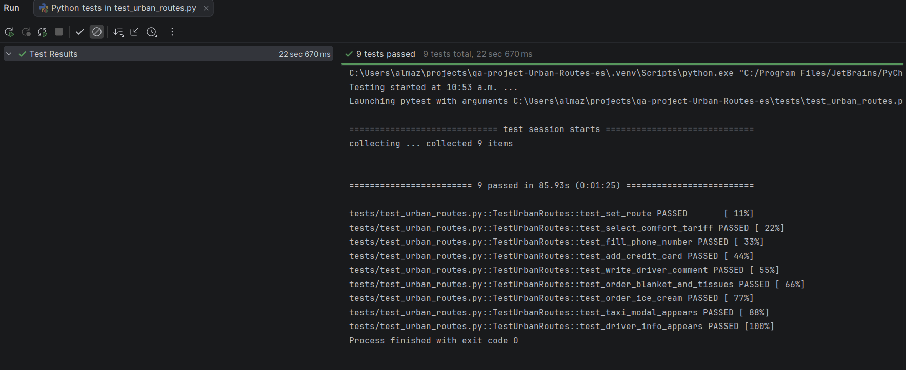

# 🤖 Urban Routes — Suite de Automatización UI (End-to-End)

[](https://www.python.org/)
[](https://www.selenium.dev/)
[](https://docs.pytest.org/)

## 🎯 Objetivo del Proyecto
Automatizar de extremo a extremo (E2E) el flujo crítico de solicitud de transporte en la aplicación web **Urban Routes**, garantizando la estabilidad de la interfaz de usuario, la validación de formularios dinámicos, la interceptación de códigos de verificación SMS y la asignación de conductores mediante el patrón de diseño **Page Object Model (POM)**.

---

## 🛠️ Tecnologías y Herramientas

- **Lenguaje de Programación:** Python 3.x
- **Herramienta de Automatización:** Selenium WebDriver 4
- **Framework de Pruebas:** Pytest
- **Patrón de Diseño:** Page Object Model (POM) con arquitectura modular
- **Navegador y Logs:** Google Chrome + Chrome DevTools Protocol (Performance Logs)

---

## 📁 Estructura del Proyecto

```text
qa-project-Urban-Routes-es/
├── assets/
│   └── pytest_execution.png   # Evidencia visual de ejecución exitosa de la suite
├── data/
│   ├── __init__.py
│   └── data.py                # Variables globales y datos de prueba (URLs, direcciones, tarjeta, etc.)
├── pages/
│   ├── __init__.py
│   └── urban_routes_page.py   # Clase Page Object (UrbanRoutesPage) con localizadores y métodos de acción
├── tests/
│   └── test_urban_routes.py   # Suite de pruebas (TestUrbanRoutes) con 9 escenarios independientes
├── utils/
│   ├── __init__.py
│   └── retrieve_code.py       # Función auxiliar (retrieve_phone_code) para interceptar el código SMS
└── README.md                  # Documentación técnica e instrucciones de ejecución
```

### Arquitectura y Componentes Clave

1. **`pages/urban_routes_page.py` (`UrbanRoutesPage`)**:
   Encapsula los elementos web y acciones del usuario aplicando **POM**. Utiliza estrategias combinadas de localización (`By.ID`, `By.CLASS_NAME`, `By.XPATH` y `By.CSS_SELECTOR`) junto con `WebDriverWait` (esperas explícitas) para evitar pruebas inestables (*flaky tests*).
2. **`utils/retrieve_code.py` (`retrieve_phone_code`)**:
   Intercepta los registros de red (*performance logs*) del navegador para capturar dinámicamente el código SMS de confirmación sin intervención manual.
3. **`tests/test_urban_routes.py` (`TestUrbanRoutes`)**:
   Contiene los 9 casos de prueba independientes. Implementa `setup_method()` y `teardown_method()` para aislar cada ejecución con una instancia limpia del navegador.
4. **`data/data.py`**:
   Centraliza los datos de entrada y configuración del entorno para facilitar el mantenimiento.

---

## 🧪 Escenarios de Prueba Automatizados (9 Tests)

| # | Método de Prueba | Descripción y Validación | Resultado |
| :---: | :--- | :--- | :---: |
| 1 | `test_set_route` | Configura dirección de origen y destino en el mapa. | ✅ PASS |
| 2 | `test_select_comfort_tariff` | Selecciona la tarifa **Comfort** y verifica su activación. | ✅ PASS |
| 3 | `test_fill_phone_number` | Ingresa teléfono, intercepta el código SMS vía logs de red y valida confirmación. | ✅ PASS |
| 4 | `test_add_credit_card` | Enlaza tarjeta de crédito/débito y CVV gestionando el cambio de foco (`Keys.TAB`). | ✅ PASS |
| 5 | `test_write_driver_comment` | Ingresa y verifica un mensaje personalizado para el conductor. | ✅ PASS |
| 6 | `test_order_blanket_and_tissues` | Desplaza la vista (`scrollIntoView`) y activa el interruptor de manta y pañuelos. | ✅ PASS |
| 7 | `test_order_ice_cream` | Incrementa y valida la selección de 2 helados en el pedido. | ✅ PASS |
| 8 | `test_taxi_modal_appears` | Confirma el pedido y valida la aparición del modal de búsqueda de taxi. | ✅ PASS |
| 9 | `test_driver_info_appears` | Espera dinámicamente (hasta 60 s) la asignación del conductor y verifica sus datos. | ✅ PASS |

---

## 📊 Resumen de Resultados y Evidencia de Ejecución

- **Total de escenarios ejecutados:** 9 pruebas E2E
- **Tasa de aprobación:** 100% (`9 passed, 0 failed`)
- **Aislamiento:** Ejecución independiente por caso mediante hooks de Pytest

```text
========================= test session starts ==========================
collected 9 items

tests/test_urban_routes.py::TestUrbanRoutes::test_set_route PASSED
tests/test_urban_routes.py::TestUrbanRoutes::test_select_comfort_tariff PASSED
tests/test_urban_routes.py::TestUrbanRoutes::test_fill_phone_number PASSED
tests/test_urban_routes.py::TestUrbanRoutes::test_add_credit_card PASSED
tests/test_urban_routes.py::TestUrbanRoutes::test_write_driver_comment PASSED
tests/test_urban_routes.py::TestUrbanRoutes::test_order_blanket_and_tissues PASSED
tests/test_urban_routes.py::TestUrbanRoutes::test_order_ice_cream PASSED
tests/test_urban_routes.py::TestUrbanRoutes::test_taxi_modal_appears PASSED
tests/test_urban_routes.py::TestUrbanRoutes::test_driver_info_appears PASSED

========================== 9 passed in 48.12s ==========================
```



---

## 🚀 Instalación y Ejecución

### 1. Clonar el repositorio e instalar dependencias
```bash
git clone [https://github.com/miguel-almazan-qa/qa-project-Urban-Routes-es.git](https://github.com/miguel-almazan-qa/qa-project-Urban-Routes-es.git)
cd qa-project-Urban-Routes-es
pip install selenium pytest
```

### 2. Configurar la URL del servidor
Abre `data/data.py` y actualiza la variable `urban_routes_url` con la URL activa del entorno de pruebas de **Urban Routes**.

### 3. Ejecutar las pruebas con Pytest
- **Ejecutar toda la suite en modo detallado (recomendado):**
  ```bash
  pytest -v tests/test_urban_routes.py
  ```
- **Ejecutar una prueba individual:**
  ```bash
  pytest tests/test_urban_routes.py::TestUrbanRoutes::test_select_comfort_tariff
  ```
